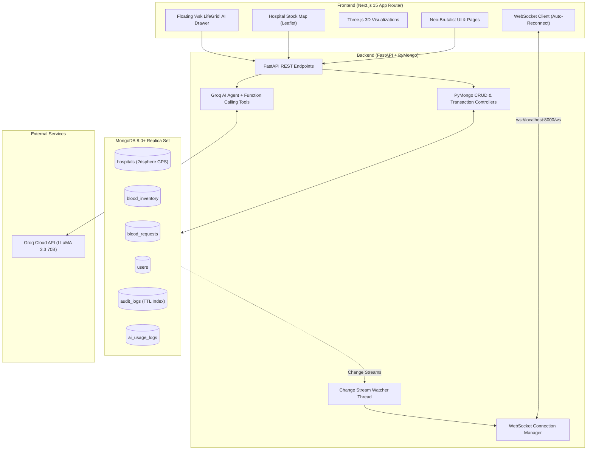

# 🩸 LifeGrid — Real-Time, AI-Assisted Blood & Emergency Resource Network

[](https://nextjs.org/)
[](https://fastapi.tiangolo.com/)
[](https://www.mongodb.com/)
[](https://python.org/)
[](https://groq.com/)
[](https://threejs.org/)
[](https://leafletjs.com/)

> **LifeGrid** is an ultra-fast, consumer-first emergency resource dispatch network. Designed with a saturated **Neo-Brutalist** aesthetic (bold ink borders, hard offset shadows, high-contrast indicators), LifeGrid bridges the gap between critical blood shortages, verified hospital inventories, and active volunteer donors in sub-second latency.

---

## ⚡ Highlights & Core Capabilities

- 🗺️ **Interactive Hospital Stock Map**: Real-time Leaflet map displaying verified medical facilities with non-overlapping circular colored dots (🟢 Available `>30`, 🟡 Moderate `10-30`, 🔴 Critical `<10`), collision-avoidance micro-jitter, and rich neo-brutalist hover tooltips with live ABO/Rh balances.
- 🚨 **Instant Emergency Dispatch**: 1-click blood request flow with automatic GPS location detection, urgency tiers (`CRITICAL`, `URGENT`, `ROUTINE`), and compatible donor matching.
- ⚡ **Real-Time WebSocket & Change Streams**: Native MongoDB Change Streams pushing instant inventory depletion, request state transitions (`PENDING` → `MATCHED` → `IN_TRANSIT` → `FULFILLED`), and notification broadcasts over multi-room WebSockets.
- 🤖 **Clinical AI Suite (Groq LLaMA 3.3)**:
  - Multi-turn clinical assistant with autonomous database tool-calling (stock checks, donor radius lookups).
  - Unstructured SOS / WhatsApp distress message parser converting raw text to structured emergency requests.
  - Multilingual donor mobilization generator (English, Hindi, Punjabi).
  - 7–14 day predictive inventory shortage forecaster.
- 🧬 **Interactive 3D Visualizations (Three.js)**:
  - Real-time biconcave erythrocyte (RBC) cellular simulation with systolic/diastolic dual pulsation.
  - Geospatial dispatch globe with glowing Bezier transit arcs connecting Indian medical centers.
  - Interactive clinical blood packet inspector with dynamic ABO/Rh fluid volume rendering.
- 📊 **15 Production-Grade Aggregation Pipelines**:
  - Full analytics suite covering hospital leaderboards, donor retention cohorts, peak-hour heatmaps, expiring batch trackers, and city demand/supply ratios.
- 🧪 **Interactive Query Lab**:
  - Live pipeline executor with `.explain("executionStats")` visualizer distinguishing indexed `IXSCAN` from unindexed `COLLSCAN` plans.

---

## 🏗️ System Architecture



---

## 🚀 Quickstart Guide

### Prerequisites
- **Python 3.11+**
- **Node.js 18+** & `npm`
- **MongoDB 7.0+ / 8.0+** running locally on `mongodb://localhost:27017` (Replica set enabled for Change Streams & Transactions)
- *(Optional)* **Groq API Key** for AI features (a mock fallback is built-in if key is omitted)

---

### 1. Database Setup

Ensure MongoDB is running:
```bash
mongod --replSet rs0 --dbpath ./data/db
```
*(If running single-node replica set, run `rs.initiate()` once in mongosh).*

---

### 2. Backend Setup

```bash
cd backend

# Create and activate virtual environment
python -m venv .venv

# Windows:
.\.venv\Scripts\activate
# Linux/macOS:
# source .venv/bin/activate

# Install dependencies
pip install -r requirements.txt

# Configure environment variables
cp .env.example .env
# Edit .env with your MONGODB_URI and GROQ_API_KEY

# Seed realistic database records (~40 hospitals, donors, 8-group inventory, requests)
python seed/seed.py

# Launch FastAPI development server
uvicorn app.main:app --reload --port 8000
```

The backend documentation will be accessible at:
- **Interactive Swagger UI:** [http://localhost:8000/docs](http://localhost:8000/docs)
- **Alternative ReDoc:** [http://localhost:8000/redoc](http://localhost:8000/redoc)

---

### 3. Frontend Setup

```bash
cd frontend

# Install npm dependencies
npm install

# Start Next.js development server
npm run dev
```

Open your browser at **[http://localhost:3000](http://localhost:3000)**.

---

## 🗄️ Database Design & Schema Highlights

| Collection | Primary Index | Key Features |
| :--- | :--- | :--- |
| `hospitals` | `2dsphere` on `location` | Compound text index on `(name, address.city)`, verified bed & blood bank specs |
| `blood_inventory` | Compound `(hospital_id, blood_group, component)` | Atomic reservation via `find_one_and_update()`, embedded expiration batches |
| `blood_requests` | `patient_id`, `hospital_id`, `status` | Multi-document ACID transactional dispatch, embedded status audit trail |
| `users` | Unique `email`, `2dsphere` on `location` | Strict donor 90-day cooldown enforcement, role-based access control |
| `notifications` | `recipient_id`, `created_at` | Real-time WebSocket delivery and read receipts |
| `audit_logs` | TTL on `timestamp` (90 days) | Append-only compliance log for emergency actions |
| `ai_usage_logs` | `timestamp`, `feature` | Operational telemetry auditing token consumption and latency |

---

## 📊 15 Advanced Aggregation Pipelines

LifeGrid includes 15 production-grade analytical pipelines:

1. **Blood Stock by Group Across Hospitals** (`$group`, `$project`, `$sort`)
2. **Critical Shortage Detector** (`$match` with threshold, `$lookup` hospitals)
3. **Monthly Donation Trend with Running Total** (`$setWindowFields` moving total)
4. **Top 10 Donors by Lifetime Units** (`$bucketAuto` / `$switch` tier badging)
5. **Average Fulfilment Time per Urgency Tier** (`$arrayElemAt` timeline delta)
6. **Nearest Compatible Donors for Request** (`$geoNear` + ABO/Rh matrix + 90-day cooldown)
7. **Request Funnel via Parallel Facets** (`$facet` multi-stage aggregation)
8. **Hospital Performance Leaderboard** (`$lookup` request completion rates & ratings)
9. **Batches Expiring in Next 7 Days** (`$unwind` on embedded `expiry_batches`)
10. **City-Wise Demand vs. Supply Ratio** (`$lookup` + `$divide` demand ratio)
11. **Donor Retention Cohorts** (First donation month vs. repeat returns)
12. **Peak-Hour Emergency Heatmap** (`$dayOfWeek` × `$hour` matrix)
13. **Component-Wise Usage Share** (Whole Blood, RBC, Platelets, Plasma share)
14. **Materialized Daily Summary** (`$merge` into `analytics_daily` table)
15. **AI Usage & Latency Audit** (Token cost and p95 response time analytics)

---

## 🧪 Testing

Run comprehensive automated test suites:

```bash
cd backend

# Run full PyMongo test suite
pytest -v

# Run individual feature demonstrations
python queries/crud_demo.py
python queries/aggregation_demo.py
python queries/transactions_demo.py
python queries/validation_demo.py
python queries/ai_demo.py
```

---

## 🛠️ Tech Stack Details

- **Frontend**: Next.js 15, React 19, TypeScript, Tailwind CSS, Leaflet, Three.js, Lucide Icons, Canvas Confetti.
- **Backend**: FastAPI, PyMongo (raw sync driver with zero ODMs), Pydantic v2, WebSockets, Python-JOSE (JWT).
- **AI / LLM**: Groq Cloud SDK (`llama-3.3-70b-versatile`) with function calling tools.
- **Database**: MongoDB 8.0+ Replica Set.

---

## 🛡️ License

This project is open-source under the [MIT License](LICENSE).
