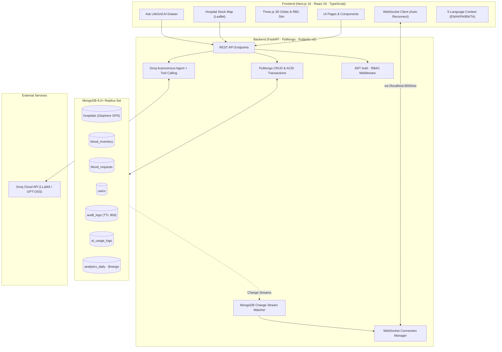

<](https://nextjs.org/)
[](https://fastapi.tiangolo.com/)
[](https://www.mongodb.com/)
[](https://python.org/)
[](https://typescriptlang.org/)
[](https://threejs.org/)
[](https://groq.com/)
[](LICENSE)

---

[Live Demo](#-quickstart-guide) · [System Architecture](#-system-architecture) · [API Reference](#-api-reference) · [15 Analytics Pipelines](#-15-production-grade-aggregation-pipelines) · [AI Clinical Suite](#-ai-clinical-suite) · [Contributing](#-contributing)

</div>

---

## What is LifeGrid?

LifeGrid is a full-stack, production-architected emergency blood resource management system built for India's healthcare ecosystem. It solves the critical gap between **where blood is available** and **where a patient urgently needs it** — in real time.

The platform connects voluntary donors, verified hospital blood banks, and clinical staff across India's major metropolitan areas through a unified intelligent network, featuring:

- Sub-second live inventory queries backed by **MongoDB Change Streams**
- Autonomous clinical AI powered by **Groq** with live database tool-calling
- **Three.js WebGL** 3D geospatial visualization with interactive orbit controls
- Full **RBAC** authentication (Admin, Hospital Staff, Donor, Requester)
- **5-language real-time UI** (English, Hindi, Punjabi, Bengali, Tamil)
- 15 production-grade MongoDB aggregation analytics pipelines

---

## Feature Overview

### 🩸 Blood Discovery & Dispatch

| Feature | Description |
|---|---|
| **Hospital Stock Map** | Real-time Leaflet map showing 40+ verified partner hospitals with color-coded availability indicators (🟢 Available, 🟡 Moderate, 🔴 Critical) |
| **Instant Blood Request** | 1-click emergency dispatch with GPS location, urgency tiers (`CRITICAL`, `URGENT`, `ROUTINE`), compatible donor radius matching |
| **Eligibility Wizard** | 5-step clinical pre-screening form for donor eligibility with haemoglobin, weight, travel, and infection history checks |
| **Donor Registration** | Voluntary lifesaver enrollment with blood group, geolocation, and 90-day donation cooldown enforcement |

### 📊 Analytics Command Center (`/analytics`)

A fully live executive clinical operations dashboard powered by real-time MongoDB aggregation:

- **Interactive 3D WebGL Network Globe** (Three.js) — rotating Pan-India blood bank mesh with metropolitan dispatch nodes, orbital rings, animated transit arcs, and mouse-drag orbit controls
- **Live Blood Group Reserve Matrix** — visual capacity bars for all 8 groups (`O+`, `O-`, `A+`, `A-`, `B+`, `B-`, `AB+`, `AB-`) with `OPTIMAL / MODERATE / DEFICIT` status badges
- **Monthly Donation Timeline** — gradient bar chart visualizing donation velocity and cumulative running total via `$setWindowFields`
- **Critical Shortage Radar** — real-time deficit alerts with hospital contact numbers and 1-click direct call
- **Hospital Leaderboard** — fulfilment rate bars, request completion stats, and star ratings ranked from live data
- **Lifesaver Honor Roll** — top donors ranked by lifetime units with Platinum/Gold loyalty badge tiers
- **Regional Deficit Watch** — metro supply-to-demand ratio meters across Delhi, Mumbai, Bengaluru, and more
- **CSE494 Pipeline Inspector Drawer** — slide-over inspector for all 15 MongoDB aggregation pipelines with stage-by-stage explanations and live JSON output

### 🤖 AI Clinical Suite (`/ai`)

Five autonomous AI-powered tabs backed by Groq's LLM platform:

| Tab | Capability |
|---|---|
| **Care Assistant** | Multi-turn clinical agent with live MongoDB tool-calling (`check_blood_inventory`, `find_nearest_hospitals`, `get_blood_compatibility`, `estimate_delivery_time`, `find_critical_shortages`) |
| **SOS Distress Parser** | Converts raw WhatsApp forwards, family voice transcriptions, and emergency dispatch messages into structured `BloodRequest` schema using LLM NER |
| **Multilingual Broadcaster** | Generates high-urgency donor mobilization alerts in English, Hindi, and Punjabi simultaneously |
| **Shortage Forecaster** | 7–14 day predictive stock depletion analysis across all 8 blood groups with recommended intervention actions |
| **System Telemetry** | Live Groq model audit — total calls, tokens processed, average latency, and MongoDB `ai_usage_logs` auditing |

### 🌍 Real-Time 5-Language UI

The entire application supports live, zero-reload language switching across:

- 🇬🇧 **English** (default)
- 🇮🇳 **Hindi** (हिन्दी)
- 🇮🇳 **Punjabi** (ਪੰਜਾਬੀ)
- 🇮🇳 **Bengali** (বাংলা)
- 🇮🇳 **Tamil** (தமிழ்)

Language selection persists via React Context and switches all nav labels, hero copy, search card instructions, and status text in real time without a page refresh.

### ⚡ Real-Time Infrastructure

- **WebSocket Change Streams**: Native MongoDB Change Streams push live inventory mutations, request status transitions (`PENDING → MATCHED → IN_TRANSIT → FULFILLED`), and notification broadcasts to all connected clients
- **Multi-Room WebSocket Manager**: Room-based real-time subscriptions per hospital, per user, and per global admin
- **Auto-Reconnect Client**: Frontend WebSocket client with exponential back-off and connection health monitoring

### 🔐 Security & RBAC

- JWT-based authentication (Python-JOSE, RS256)
- Role-Based Access Control: `ADMIN`, `HOSPITAL_STAFF`, `DONOR`, `REQUESTER`
- Route and API protection via `AuthGuard` component with allowed-role enforcement
- Demo accounts gated strictly behind `NEXT_PUBLIC_DEMO_MODE=true` — absent in any production build

---

## 🏗️ System Architecture



---

## 🗂️ Repository Structure

```
LifeGrid/
├── backend/
│   ├── app/
│   │   ├── main.py                 # FastAPI application entry point
│   │   ├── routers/                # Route modules (auth, blood, hospitals, analytics, ai, ws)
│   │   ├── models/                 # Pydantic v2 request/response schemas
│   │   ├── core/                   # JWT, security, config, database connection
│   │   └── services/               # Business logic, AI agent, change stream watcher
│   ├── queries/                    # Standalone demo scripts (CRUD, aggregation, transactions)
│   ├── seed/                       # Realistic data seeder (42 hospitals, 500+ donors, 8-group inventory)
│   ├── tests/                      # Pytest test suite
│   ├── requirements.txt
│   └── .env.example
│
├── frontend/
│   ├── src/
│   │   ├── app/                    # Next.js App Router pages
│   │   │   ├── page.tsx            # Landing page
│   │   │   ├── analytics/          # Executive clinical command center
│   │   │   ├── ai/                 # AI Clinical Suite (5 tabs)
│   │   │   ├── requests/           # Blood request management
│   │   │   ├── inventory/          # Hospital blood stock view
│   │   │   ├── donate/             # Donor eligibility + registration
│   │   │   ├── admin/              # Admin dashboard
│   │   │   ├── query-lab/          # Live MongoDB pipeline executor
│   │   │   └── compliance/         # DPDP, Privacy, Terms pages
│   │   ├── components/
│   │   │   ├── Navbar.tsx          # 5-language switcher, RBAC-aware auth header
│   │   │   ├── ThreeNetworkGlobe.tsx  # 3D WebGL emergency network globe
│   │   │   ├── three/              # BloodBagCanvas, RBC simulation, sphere scenes
│   │   │   ├── AuthGuard.tsx       # Role-protected route wrapper
│   │   │   └── Footer.tsx
│   │   └── lib/
│   │       ├── api.ts              # Typed API client
│   │       └── i18n.tsx            # 5-language React context & translation dictionary
│   └── .env.local.example
│
├── docker-compose.yml
├── CHANGELOG.md
└── README.md
```

---

## 🚀 Quickstart Guide

### Prerequisites

| Requirement | Version |
|---|---|
| Python | 3.11+ |
| Node.js | 18+ |
| MongoDB | 7.0+ (replica set enabled) |
| npm | 9+ |
| Groq API Key | Optional — AI features degrade gracefully |

### Step 1 — Start MongoDB (Replica Set)

Change Streams and multi-document transactions require a replica set. Start with:

```bash
mongod --replSet rs0 --dbpath ./data/db
```

If running for the first time, initiate the replica set in `mongosh`:

```js
rs.initiate()
```

### Step 2 — Backend Setup

```bash
cd backend

# Create and activate virtual environment
python -m venv .venv
.venv\Scripts\activate          # Windows
# source .venv/bin/activate     # Linux / macOS

# Install all Python dependencies
pip install -r requirements.txt

# Configure environment (copy and edit with your keys)
cp .env.example .env
```

Edit `backend/.env`:

```env
MONGODB_URI=mongodb://localhost:27017/?replicaSet=rs0
DB_NAME=lifegrid
GROQ_API_KEY=your_groq_api_key_here
JWT_SECRET_KEY=your_very_long_random_secret
ALLOWED_ORIGINS=http://localhost:3000
```

```bash
# Seed 42 hospitals, 500+ donors, full 8-group blood inventory, and demo users
python seed/seed.py

# Start FastAPI with hot-reload
uvicorn app.main:app --reload --port 8000
```

API documentation is now live at:
- **Swagger UI**: [http://localhost:8000/docs](http://localhost:8000/docs)
- **ReDoc**: [http://localhost:8000/redoc](http://localhost:8000/redoc)

### Step 3 — Frontend Setup

```bash
cd frontend

# Install dependencies
npm install

# Configure environment
cp .env.local.example .env.local
```

Edit `frontend/.env.local`:

```env
NEXT_PUBLIC_API_URL=http://localhost:8000
NEXT_PUBLIC_WS_URL=ws://localhost:8000
NEXT_PUBLIC_DEMO_MODE=true          # Set to false in production
```

> **Map Tiles** — LifeGrid defaults to free OpenStreetMap tiles with no API key required.
> You can optionally upgrade to MapTiler or Stadia Maps by editing `NEXT_PUBLIC_MAP_TILE_URL`.

```bash
# Start Next.js development server
npm run dev
```

Open [http://localhost:3000](http://localhost:3000) in your browser.

### Demo Accounts (Development Only)

The following accounts are seeded when `NEXT_PUBLIC_DEMO_MODE=true`:

| Role | Email | Password |
|---|---|---|
| Admin | `admin@lifegrid.in` | `admin123` |
| Hospital Staff | `staff@riversidehospital.in` | `staff123` |
| Donor | `donor@lifegrid.in` | `donor123` |
| Requester | `requester@lifegrid.in` | `req123` |

> [!CAUTION]
> **Before deploying to production**, set `NEXT_PUBLIC_DEMO_MODE=false` to completely strip demo login buttons from the build, and permanently delete all seeded demo accounts from your MongoDB database:
> ```js
> db.users.deleteMany({
>   email: { $in: ["admin@lifegrid.in", "staff@riversidehospital.in", "donor@lifegrid.in", "requester@lifegrid.in"] }
> })
> ```

---

## 🗄️ Database Design & Schema

### Collections

| Collection | Primary Index | Key Design Points |
|---|---|---|
| `hospitals` | `2dsphere` on `location` | Compound text index on `(name, address.city)`, verified bed count, blood bank specialization |
| `blood_inventory` | Compound `(hospital_id, blood_group, component)` | Atomic reservation via `findOneAndUpdate` with optimistic locking, embedded `expiry_batches` array |
| `blood_requests` | `patient_id`, `hospital_id`, `status` | Multi-document ACID transaction dispatch, embedded status audit trail array |
| `users` | Unique `email`, `2dsphere` on `location` | 90-day donor cooldown enforcement, role-based access, hashed credentials |
| `notifications` | `recipient_id`, `created_at` | Real-time WebSocket delivery and read-receipt tracking |
| `audit_logs` | TTL index on `timestamp` (90 days) | Append-only compliance log for all emergency actions per DPDP norms |
| `ai_usage_logs` | `timestamp`, `feature` | Operational LLM telemetry — token consumption, latency percentiles, model version |
| `analytics_daily` | `date` | Materialized daily summaries persisted via `$merge` for dashboard cold-start acceleration |

### Key Design Patterns

- **Atomic Inventory Reservation** — Uses `findOneAndUpdate` with `$inc` on `units_available` inside a session to prevent double-allocation under concurrent emergency requests
- **ACID Multi-Document Transactions** — Blood request creation atomically debits inventory and creates the request document in a single commit/rollback boundary
- **Geospatial Donor Matching** — `$geoNear` aggregation with ABO/Rh compatibility matrix filter and 90-day cooldown guard
- **Change Streams → WebSocket** — Background thread watches `blood_inventory` and `blood_requests` collections and pushes mutations to relevant WebSocket rooms in real time

---

## 📊 15 Production-Grade Aggregation Pipelines

All 15 pipelines are live, executable from the `/analytics` Pipeline Inspector drawer, and individually testable via `python queries/aggregation_demo.py`.

| # | Pipeline | Key MongoDB Stage(s) | Purpose |
|---|---|---|---|
| 1 | Blood Stock by Group | `$group`, `$sort` | Total live units per blood type across all hospitals |
| 2 | Critical Shortage Detector | `$match`, `$lookup`, `$unwind` | Inter-collection join to surface hospitals below 5-unit threshold |
| 3 | Monthly Donation Running Total | `$group`, `$setWindowFields` | Cumulative blood volume with MongoDB 5.0+ analytical window function |
| 4 | Top Donors by Lifetime Units | `$group`, `$switch`, `$limit` | Ranked lifesavers with dynamic Platinum/Gold/Silver badge assignment |
| 5 | Fulfilment Time by Urgency | `$project`, `$group` | Average minutes from triage to bedside, split by CRITICAL / URGENT / NORMAL |
| 6 | Nearest Compatible Donors | `$geoNear`, `$match` | Geospatial distance query with ABO/Rh matrix + 90-day cooldown filter |
| 7 | Request Funnel (Parallel Facets) | `$facet` | Multi-dimensional stats (by status, urgency, blood group) in one DB pass |
| 8 | Hospital Performance Leaderboard | `$lookup`, `$addFields`, `$sort` | Fulfilment rate percentage computed inline via `$divide` |
| 9 | Expiring Batches (7-Day Alert) | `$unwind`, `$match` | Deconstructs embedded `expiry_batches` array and filters on ISO timestamp |
| 10 | City Demand vs. Supply Ratio | `$group`, `$lookup`, `$divide` | Cross-collection demand/supply deficit ratio per metro hub |
| 11 | Donor Retention Cohort | `$group`, `$bucketAuto` | Repeat vs. one-time donor frequency distribution analysis |
| 12 | Peak-Hour Request Heatmap | `$dayOfWeek`, `$hour`, `$group` | Bivariate emergency dispatch matrix for operational staffing optimization |
| 13 | Component Usage Breakdown | `$facet`, `$unwind` | Share split across Whole Blood, RBC (PRBC), Plasma (FFP), Platelets |
| 14 | Materialized Daily Summary | `$group`, `$merge` | Incremental analytical cache with `whenMatched: replace` upsert strategy |
| 15 | AI Engine Audit & Token Telemetry | `$match`, `$group`, `$sort` | Groq LLM cost, latency percentiles, and usage trends from `ai_usage_logs` |

---

## 🤖 AI Clinical Suite

The AI suite is powered by **Groq's inference API** using two model configurations:

| Model Role | Model ID | Use Case |
|---|---|---|
| Orchestration & Reasoning | `openai/gpt-oss-120b` | Multi-turn clinical chat with tool-calling |
| Distress Parsing & Translation | `openai/gpt-oss-20b` | SOS text parsing, schema extraction, multilingual broadcast |

### Agent Tool Functions

The autonomous agent has direct, real-time access to the following MongoDB-backed tools:

```python
check_blood_inventory(blood_group, city, component?)   # Live inventory query
find_nearest_hospitals(city, radius_km?)               # Geospatial proximity lookup
get_blood_compatibility(patient_blood_group)           # ABO/Rh compatibility matrix
estimate_delivery_time(donor_city, hospital_city)      # Logistics routing estimate
find_critical_shortages(threshold_units?)              # Network-wide deficit scan
```

All tool results are streamed directly into the chat response and logged to `ai_usage_logs` with token counts and latency for full audit transparency.

---

## 🏃 Running & Testing

### Backend Tests

```bash
cd backend

# Full pytest suite
pytest -v

# Individual feature demos (CRUD, aggregation, AI)
python queries/crud_demo.py
python queries/aggregation_demo.py
python queries/transactions_demo.py
python queries/validation_demo.py
python queries/ai_demo.py
```

### Frontend E2E Tests (Playwright)

```bash
cd frontend

# Run all Playwright end-to-end tests
npx playwright test

# Run a specific test (e.g., eligibility wizard)
npx playwright test tests/eligibility-wizard.spec.ts

# View interactive test report
npx playwright show-report
```

### Build for Production

```bash
cd frontend
npm run build
npm start
```

---

## 🌐 API Reference

The full interactive API reference is auto-generated by FastAPI at [http://localhost:8000/docs](http://localhost:8000/docs). Key endpoint groups:

| Prefix | Description |
|---|---|
| `/api/auth` | Registration, login, JWT refresh |
| `/api/hospitals` | List, search, geoNear hospital queries |
| `/api/blood` | Blood request CRUD, inventory check, status transitions |
| `/api/donors` | Donor registration, eligibility check, nearest donors |
| `/api/analytics/*` | 15 aggregation pipeline endpoints |
| `/api/ai/*` | Chat, SOS parse, outreach generate, shortage forecast |
| `/ws/{room}` | WebSocket connection for real-time updates |

---

## 🛠️ Tech Stack

### Frontend

| Technology | Version | Purpose |
|---|---|---|
| Next.js | 16.x | App Router, SSR, dynamic imports |
| React | 19.x | UI component model |
| TypeScript | 5.x | Full type safety |
| Tailwind CSS | 4.x | Utility-first styling |
| Three.js | 0.186+ | 3D WebGL visualizations (globe, RBC sim, blood bag) |
| @react-three/fiber | 9.x | React renderer for Three.js |
| Leaflet | 1.9+ | Interactive hospital stock map |
| Framer Motion | 14.x | Micro-animations and page transitions |
| Lucide React | 1.58+ | Icon system |
| Plus Jakarta Sans | Google Fonts | Primary brand typeface |

### Backend

| Technology | Version | Purpose |
|---|---|---|
| FastAPI | 0.115+ | ASGI REST API framework |
| PyMongo | 4.x (sync) | Raw MongoDB driver — zero ODM overhead |
| Pydantic | v2 | Request/response schema validation |
| Python-JOSE | — | JWT creation and verification |
| Uvicorn | — | ASGI server with hot reload |
| Groq SDK | — | LLM inference with tool-calling |

### Database & Infrastructure

| Technology | Purpose |
|---|---|
| MongoDB 8.0+ | Primary data store — replica set for Change Streams & transactions |
| MongoDB Change Streams | Real-time inventory mutation events |
| WebSockets (FastAPI) | Live client notification delivery |
| Docker Compose | Optional containerized local environment |

---

## 🐳 Docker Setup (Optional)

A `docker-compose.yml` is provided for a fully containerized local environment:

```bash
docker compose up --build
```

This starts MongoDB (with replica set initialization), the FastAPI backend, and seeds the database automatically.

---

## 🔒 Security Considerations

> [!IMPORTANT]
> Before deploying LifeGrid to any production or publicly accessible environment:
>
> 1. **Set `NEXT_PUBLIC_DEMO_MODE=false`** in your production environment. When this variable is absent or false, all demo login buttons are completely stripped from the compiled build — they do not render, and their code is tree-shaken out.
>
> 2. **Delete all seeded demo accounts** from your production MongoDB database:
>    ```js
>    db.users.deleteMany({
>      email: { $in: ["admin@lifegrid.in", "staff@riversidehospital.in", "donor@lifegrid.in", "requester@lifegrid.in"] }
>    })
>    ```
>
> 3. **Rotate all secrets**: Use strong, randomly generated values for `JWT_SECRET_KEY` and never commit `.env` files to version control.
>
> 4. **Enable MongoDB authentication**: Configure MongoDB with username/password authentication before exposing to a network.

---

## 📁 Environment Variables Reference

### Backend (`backend/.env`)

| Variable | Required | Description |
|---|---|---|
| `MONGODB_URI` | ✅ | Full MongoDB connection string with replica set |
| `DB_NAME` | ✅ | Target database name (default: `lifegrid`) |
| `GROQ_API_KEY` | ⚠️ Optional | Groq Cloud API key — AI features degrade gracefully without it |
| `JWT_SECRET_KEY` | ✅ | Strong random secret for JWT signing |
| `ALLOWED_ORIGINS` | ✅ | Comma-separated allowed CORS origins |

### Frontend (`frontend/.env.local`)

| Variable | Required | Description |
|---|---|---|
| `NEXT_PUBLIC_API_URL` | ✅ | Backend REST API base URL |
| `NEXT_PUBLIC_WS_URL` | ✅ | Backend WebSocket base URL |
| `NEXT_PUBLIC_DEMO_MODE` | ⚠️ Dev only | Enable `true` for development to show demo login buttons |
| `NEXT_PUBLIC_MAP_TILE_URL` | Optional | Custom map tile server URL (defaults to OpenStreetMap) |
| `NEXT_PUBLIC_MAP_ATTRIBUTION` | Optional | Attribution string for custom tile provider |

---

## 🤝 Contributing

Contributions, bug reports, and feature requests are welcome.

1. Fork the repository
2. Create a feature branch: `git checkout -b feat/your-feature-name`
3. Make your changes following the existing code style and commit conventions (`feat:`, `fix:`, `style:`, `refactor:`, `docs:`)
4. Push your branch: `git push origin feat/your-feature-name`
5. Open a Pull Request against `main`

Please ensure any backend changes include corresponding pytest coverage, and frontend changes maintain Playwright E2E test coverage for critical user flows.

---

## 📄 License

This project is open-source under the [MIT License](LICENSE).

---

<div align="center">

Built with care for India's blood donor ecosystem.

**LifeGrid Emergency Resource Network** · © 2026

</div>
]]>
